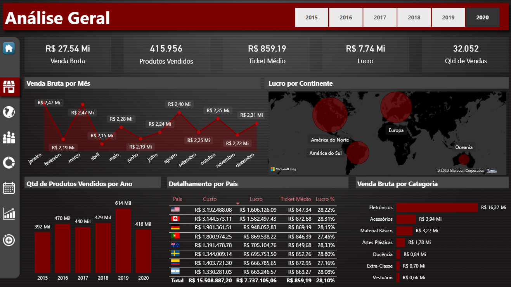
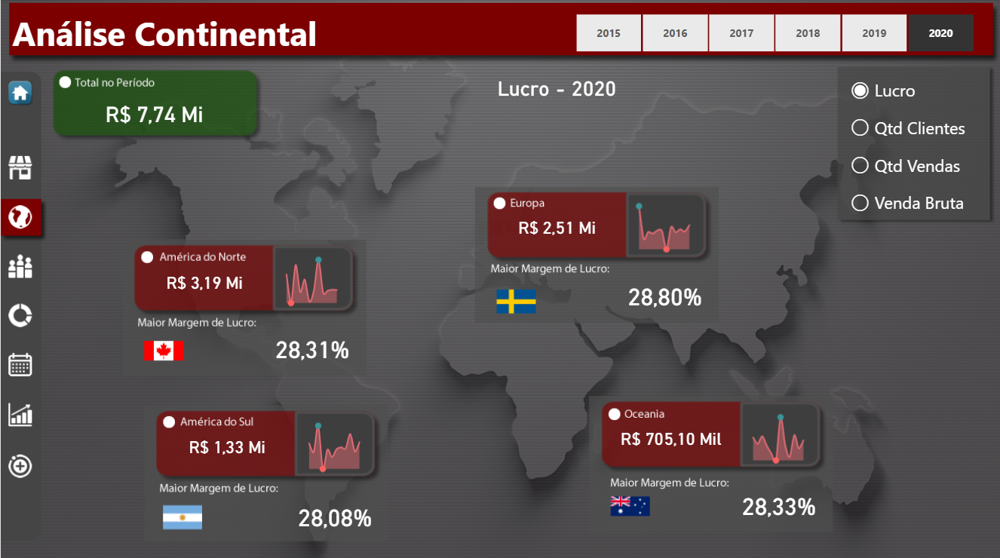
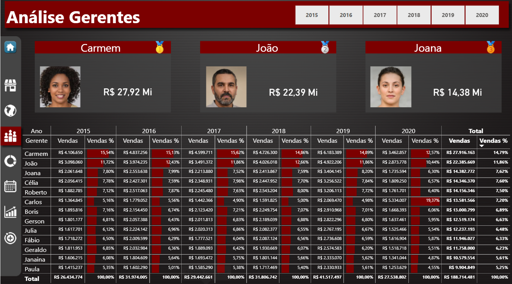
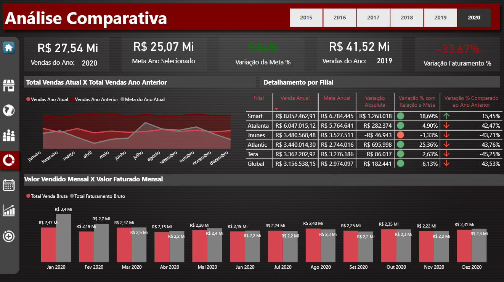
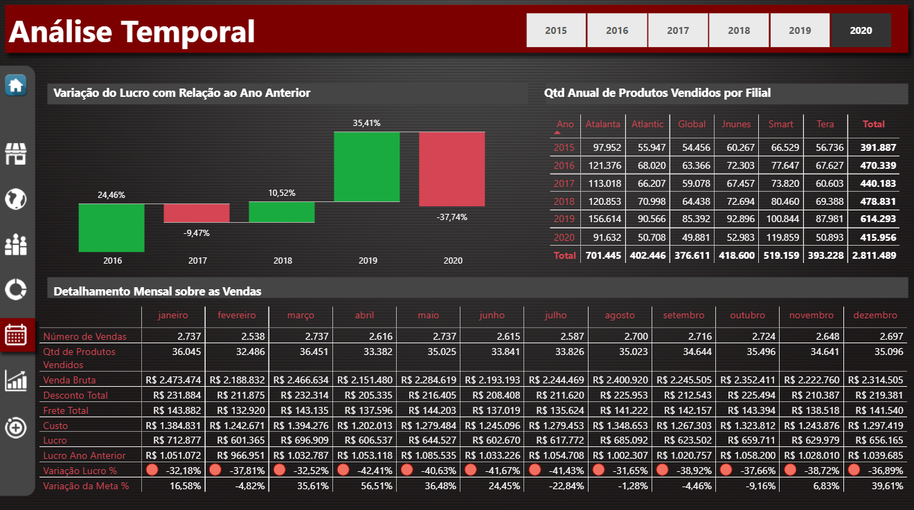
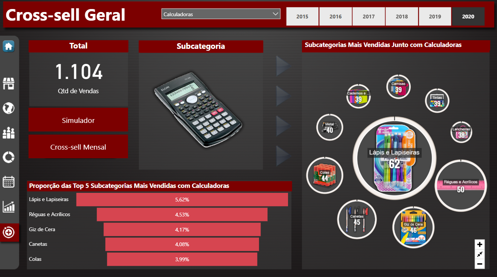
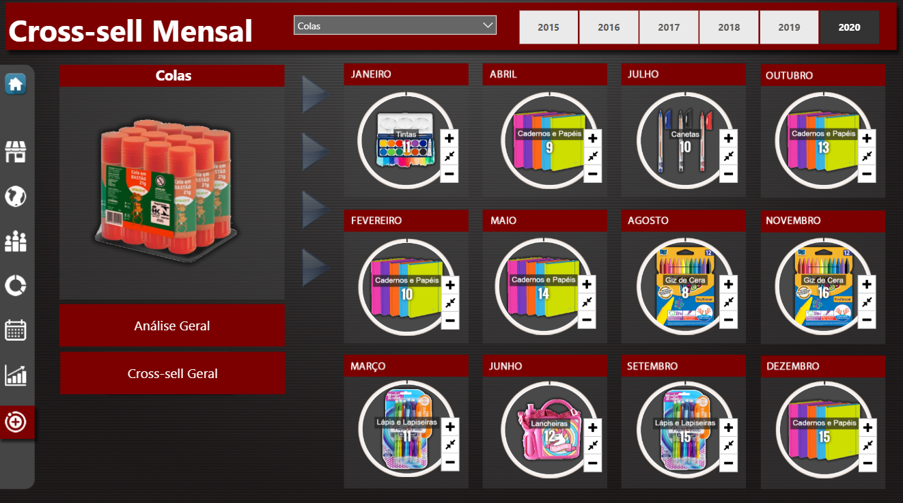
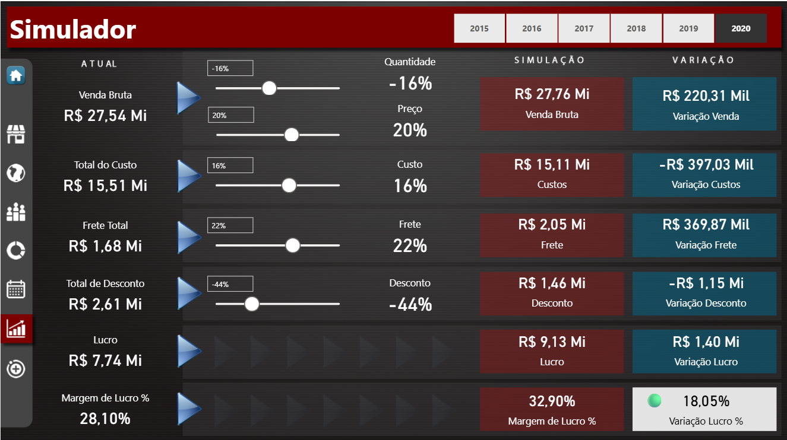
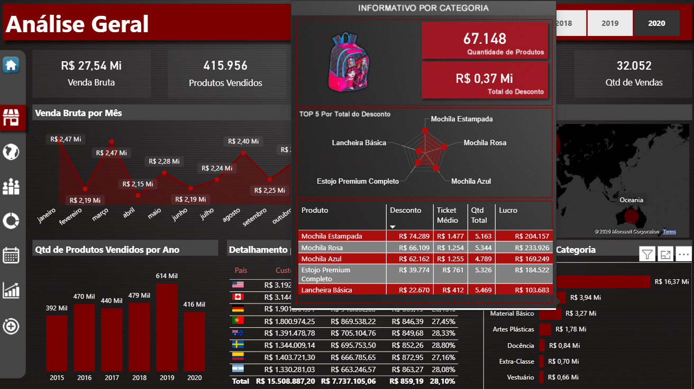
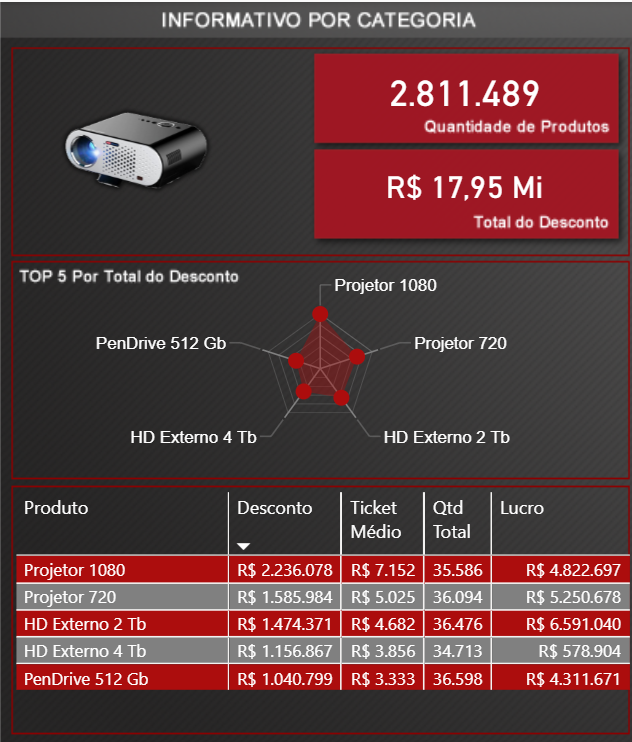

# Dashboard de Análise Comercial | Power BI

Relatório em Power BI para análise comercial: vendas, lucro, metas e desempenho por filial, continente, país, gerente e categoria, com comparativo entre anos, cross-sell e simulação de cenários.

> **Projeto de curso.** Desenvolvido durante o curso **Master DAX - Power BI orientado a projeto**, do instrutor **Felipe Mafra** (Udemy), focado em fórmulas DAX. A base de dados e a lógica das medidas DAX vêm do material do curso. Todo o restante (design, navegação, modelo e ajustes) está detalhado na seção [O que eu fiz](#o-que-eu-fiz).

## Objetivo

Reunir em um único relatório as respostas para perguntas como:

- Quanto a empresa vendeu e lucrou, e como isso se compara às metas e ao ano anterior?
- Quais filiais, continentes e gerentes mais contribuem para o resultado?
- Como o desempenho evolui mês a mês e ano a ano?
- Quais subcategorias são mais vendidas em conjunto com uma subcategoria escolhida (cross-sell), no ano e mês a mês?
- O que acontece com o lucro se o preço, quantidade, custo, frete ou desconto mudarem?

## Ferramentas

- Power BI (DAX, Power Query e modelagem de dados)

## Estrutura do relatório

| Página | O que mostra |
|---|---|
| Análise Geral | Principais indicadores, venda bruta por mês, lucro por continente, quantidade de produtos vendidos por ano, detalhamento de indicadores por país e venda por categoria |
| Análise Continental | Lucro, quantidade de clientes, quantidade de vendas e venda bruta por continente, com o país com maior margem de lucro de cada continente num determinado ano |
| Análise Gerentes | Ranking de gerentes e participação nas vendas, ano a ano |
| Análise Comparativa | KPIs de variação da meta e do faturamento em relação ao ano anterior, vendas do ano contra a meta e o ano anterior, detalhamento por filial, valor vendido mensal (regime de competência) x valor faturado mensal (regime de caixa) |
| Análise Temporal | Variação do lucro entre anos, quantidades de produtos vendidos por filial, detalhamento mensal das vendas |
| Cross-sell Geral e Mensal | Subcategorias mais vendidas junto com a subcategoria escolhida, no ano e mês a mês |
| Simulador | Efeito de variações em quantidade, preço, custo, frete e desconto sobre o lucro e a margem e a variação do lucro com relação ao cenário atual |
| Tooltip | Informativo por categoria, exibido ao passar o mouse |

Todas as páginas de análise têm menu lateral de navegação e filtro por ano.

## Números do relatório (2020)

| Indicador | Valor |
|---|---|
| Venda bruta | R$ 27,54 Mi |
| Lucro | R$ 7,74 Mi |
| Margem de lucro | 28,10% |
| Quantidade de vendas | 32.052 |
| Produtos vendidos | 415.956 |
| Ticket médio | R$ 859,19 |
| Meta do ano | R$ 25,07 Mi |
| Venda bruta 2019 | R$ 41,52 Mi |

**Cálculo do lucro:** venda bruta − custo − frete − desconto.

## Principais leituras

- Em 2020, a venda bruta ficou **9,84% acima da meta**, mas **33,67% abaixo de 2019**, porque a meta do ano era bem menor que o realizado do ano anterior.
- A filial **Smart** foi a única a crescer em relação a 2019 (+15,45%). As demais caíram entre 42% e 45%, e a **Jnunes** foi a única abaixo da meta (−1,33%).
- A categoria **Eletrônicos** responde por cerca de 59% da venda bruta de 2020 (R$ 16,37 Mi de R$ 27,54 Mi).
- Por continente, a **América do Norte** lidera o lucro de 2020 (R$ 3,19 Mi), seguida de Europa (R$ 2,51 Mi). A maior margem é da Suécia (28,80%).
- **Entre anos (2015 a 2020):** 2019 foi o melhor ano em venda bruta (R$ 41,52 Mi) e em produtos vendidos (614 mil). O lucro subiu 35,41% em 2019 e recuou 37,74% em 2020.
- **Cross-sell (2020):** das 1.104 vendas com calculadoras, a subcategoria mais frequente junto foi Lápis e Lapiseiras (62 vendas, 5,62%), seguida de Réguas e Acrílicos (4,53%) e Giz de Cera (4,17%). Para colas, a subcategoria Cadernos e Papéis foi a mais vendida junto em 5 dos 12 meses.

## Prints

### Análise Geral

*Indicadores do ano, venda bruta mensal, lucro por continente, detalhamento por país e venda por categoria.*

### Análise Continental

*Lucro por continente, com seletor para alternar a métrica (lucro, clientes, vendas e venda bruta).*

### Análise Gerentes

*Ranking acumulado de 2015 a 2020 e participação de cada gerente nas vendas por ano.*

### Análise Comparativa

*Vendas do ano x meta e ano anterior, com detalhamento por filial e valor vendido mensal (regime de competência) x valor faturado mensal (regime de caixa).*

### Análise Temporal

*Variação do lucro em relação ao ano anterior, quantidades de produtos vendidos por filial anualmente e detalhamento mensal das vendas.*

### Cross-sell Geral

*Subcategorias mais vendidas junto com a subcategoria selecionada (neste print, calculadoras).*

### Cross-sell Mensal

*Subcategoria mais vendida junto com a selecionada em cada mês (neste print, colas).*

### Simulador

*Simulação de cenário: variações em quantidade, preço, custo, frete e desconto, com o efeito sobre lucro e margem de lucro.*

### Tooltip

*Informativo por categoria exibido ao passar o mouse sobre um visual.*

*O mesmo tooltip, mostrando os cinco produtos com maior desconto.*

## O que eu fiz

Este projeto veio de um curso focado em fórmulas DAX. A parte que desenvolvi foi:

1. Design do relatório e navegação entre as páginas
2. Criação dos relacionamentos entre as tabelas (modelo de dados)
3. Títulos dinâmicos
4. Correção e melhoria de gráficos e filtros
5. Inclusão de bandeiras e imagens que não estavam funcionando
6. Revisão da nomenclatura de medidas e títulos (por exemplo, "Receita Líquida" passou a "Lucro", já que o cálculo desconta custo, frete e desconto)

## Contato

- LinkedIn: [Estêvão](https://www.linkedin.com/in/estevao-tannus-barbosa/)
